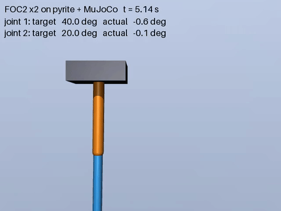

# FOC2 in simulation: two servos driving a MuJoCo arm

Two unmodified FOC2 servos, each on a simulated B-G431B-ESC1 (STM32G431CB), drive the two joints of a
2-link arm. The [Pyrite](https://simantic.dev) simulator runs the firmware and MuJoCo simulates the arm.



## What runs

- **Firmware:** FOC2 from this repo, `01-Firmware/B-G431B-ESC1-v2`. `sim/build.sh` builds it with two of
  FOC2's documented user settings changed: `SENSOR_TYPE AS5600_I2C` and `PERFORM_AUTO_CALIBRATION_AT_STARTUP`.
  Joint 2 also gets CAN ID 2 (`REG_ID_VALUE`). No logic is changed.
- **Peripherals on each board:** the simulator runs FOC2's own register-level code for TIM1 6-step PWM, the
  OPAMP current sense, ADC + DMA, CORDIC, I2C (AS5600 encoder) and FDCAN.
- **Motor and bridge:** `plant.py` models each joint's motor electrically. The motor torque turns a
  MuJoCo hinge through a 5:1 gear (`arm.py`).
- **Arm physics:** MuJoCo handles gravity, link inertia and how the two joints pull on each other. Both
  joints share one MuJoCo world.
- **Commands:** `can_host.py` sits on the CAN bus. It waits for FOC2's startup calibration on both boards,
  arms them, then commands three poses.

## Run

```sh
SIM=/path/to/sim ./sim/demo
```

- **Needs:** the `sim` binary and Python 3.12.
- **First run:** it creates `sim/.venv` with mujoco and imageio.
- **Time:** about 9 s of arm time takes a few minutes, because it simulates two boards cycle by cycle.
- **Output:** the settle error per pose, then `sim/arm.mp4`.
- **Rebuild the firmware:** `sim/build.sh` (needs `arm-none-eabi-gcc`).

## Limits

- Switching is averaged, the sensors and the gearbox are ideal, and the motor numbers are an example
  gimbal motor.
- This arm has not been built on real hardware.
- Joint 1 sags about 1 degree under gravity, because FOC2's position loop is P+D with no integral term.
